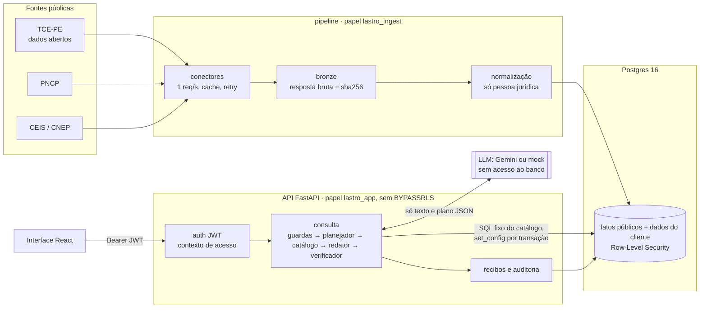
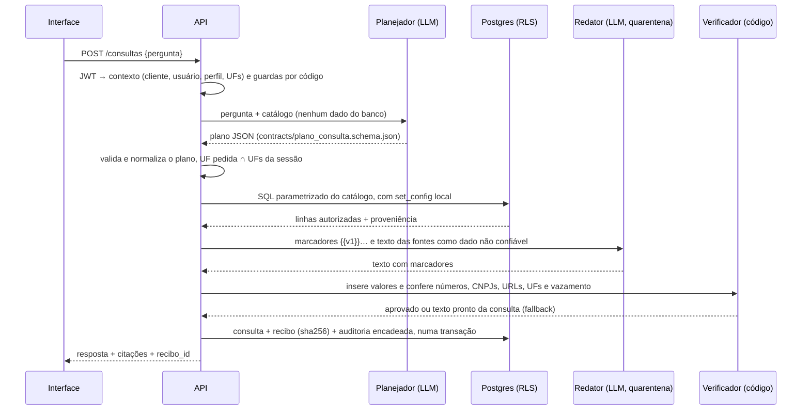

<p align="center">
  
</p>

<h1 align="center">Lastro</h1>

<p align="center"><strong>Radar de risco de fornecedores com recibo verificável</strong><br>
Hack Garanhuns Tech 2026 · Desafio 1 · Equipe KYU</p>

---

O Lastro cruza dados públicos de contratações e sanções e responde perguntas em linguagem natural sobre um fornecedor. As fontes são os dados abertos do TCE-PE, o PNCP, o CEIS e o CNEP. Cada número da resposta aponta para a linha e a fonte oficial de onde veio, e cada resposta gera um recibo com hash que pode ser conferido depois.

O controle de acesso por estado, perfil e cliente fica no Postgres (Row-Level Security), e não no prompt. A LLM nunca consulta o banco e nunca escreve números.

- Produto e arquitetura completa: [`SPEC.md`](SPEC.md) · decisões: [`docs/adr/`](docs/adr/) · tarefas: [`docs/backlog.md`](docs/backlog.md)
- Contratos congelados: [`contracts/`](contracts/) · regras de trabalho: [`AGENTS.md`](AGENTS.md)

## Arquitetura



### Fluxo de uma consulta



### Garantias por construção

| Garantia | Como | Onde |
|---|---|---|
| Escopo aplicado pelo banco | Cada transação define `app.tenant_id`, `app.usuario_id`, `app.perfil` e `app.ufs` com `set_config(..., true)`. As políticas RLS com `FORCE ROW LEVEL SECURITY` filtram todas as tabelas; sem contexto, nada é visível | `backend/app/core/db.py`, `db/migrations/002_rls.sql`, ADR-001 |
| LLM fora do banco | O planejador só escolhe uma intent de um catálogo fechado e preenche parâmetros tipados. O SQL é fixo e versionado (Action-Selector, Plan-Then-Execute) | `backend/app/modules/catalogo/`, ADR-002 |
| Números só do resultado | O redator escreve com marcadores `{{vN}}` e o código insere os valores. O verificador reprova número, CNPJ, data, URL ou UF que não veio do resultado e cai no texto pronto da intent | `backend/app/llm/verificador.py`, ADR-003 |
| Injeção armazenada contida | O texto vindo das fontes entra como `<dado_nao_confiavel>`. O redator não tem ferramentas nem contexto de acesso. O seed 020 é um fornecedor sintético com instruções maliciosas | `backend/app/llm/texto_externo.py`, `db/seeds/020_demo_ataque.sql` |
| Recibo verificável | O conteúdo segue `contracts/recibo.schema.json` e o hash é o sha256 do JSON canônico, gravado numa tabela sem `UPDATE` nem `DELETE` para a API | `backend/app/modules/recibos/` |
| Auditoria encadeada | Cada evento leva o hash do anterior, por cliente. O `seq` é sorteado depois do lock (migration 006) | `db/migrations/001_schema.sql`, `006_*.sql` |
| Proveniência por linha | Toda linha pública tem `fonte_id`, `id_origem`, `url_origem`, `coletado_em`, `hash_conteudo` e `arquivo_bruto_id` | `pipeline/`, `db/migrations/001_schema.sql` |
| Funciona sem LLM | Com `LLM_PROVIDER=mock`, ou com o provedor fora, cota esgotada ou plano inválido, o roteador por regras planeja e o texto pronto da intent responde | `backend/app/llm/regras.py`, `marcadores.py` |

### Stack

| Camada | Escolha |
|---|---|
| Banco | PostgreSQL 16: RLS, views `security_invoker`, full-text em português, pgcrypto |
| API | Python 3.12, FastAPI, Pydantic v2, psycopg 3 com SQL explícito (sem ORM), JWT HS256 |
| Pipeline | Python 3.12, httpx, typer; ingestão idempotente por `(fonte_id, id_origem)` |
| LLM | Provedor próprio com `gemini` (google-genai) e `mock`; prompts versionados em `backend/app/llm/prompts/` |
| Interface | React 18, Vite, TypeScript `strict`, TanStack Query, React Router, Tailwind |
| Execução | Docker Compose (`db`, `api`, `web` e `pipeline` sob demanda) |

### Estrutura

```
backend/   API: core/ (config, sessão com contexto, erros), modules/ (auth, policy, catalogo, consulta,
           recibos, auditoria), llm/ (provedores, planejador, regras, redator, verificador, prompts)
pipeline/  conectores (pe_portal, pncp, ceis, cnep), bronze, normalização, qualidade
db/        migrations (contrato congelado) e seeds de demonstração
frontend/  interface: 5 telas (consulta, recibo, acesso, auditoria, fontes)
contracts/ recibo, plano de consulta e API (congelados)
eval/      gabarito de perguntas e suíte de ataques
docs/      ADRs, catálogo de fontes, dicionário, modelo de ameaças, integração
```

## Rodar do zero

Pré-requisitos: Docker com Compose v2 e `make`. No Windows, use o Git Bash com `make`; sem ele, rode os comandos equivalentes do [`Makefile`](Makefile). Portas: `5432` (configurável por `DB_PORTA_HOST`), `8000` e `5173`.

```bash
git clone <url-do-repositório> lastro
cd lastro
cp .env.example .env    # troque POSTGRES_PASSWORD, APP_DB_PASSWORD, INGEST_DB_PASSWORD e JWT_SECRET
make demo               # apaga o banco, aplica migrations e seeds, carrega data/fixtures, sobe API e interface
```

- Interface: http://localhost:5173 (com `DEMO_MODE=true`, o login mostra o seletor dos usuários de demonstração)
- API: http://localhost:8000/docs · saúde: http://localhost:8000/health → `{"status":"ok","db":"ok","llm":"mock"}`

Passo a passo equivalente: `make up`, `make seed` e `make ingest-offline`. O `make up` reconstrói as imagens. Um `docker compose up -d` sem `--build` reaproveita imagens antigas e mostra código antigo.

As senhas do banco só valem na criação do volume. Se trocar alguma depois, rode `make reset-db`.

### Usuários de demonstração

Senha `demo123`, só para desenvolvimento.

| E-mail | Cliente | Perfil | UFs |
|---|---|---|---|
| ana@alfa.demo | Cliente Alfa | analista | PE |
| caio@alfa.demo | Cliente Alfa | auditor | PE |
| gil@alfa.demo | Cliente Alfa | gestor | PE |
| admin@alfa.demo | Cliente Alfa | admin | PE, AL |
| bia@beta.demo | Cliente Beta | analista | AL |

Perguntas que respondem com os dados do `make demo`:
- como **ana**: "Faça um resumo do fornecedor 99.000.001/0001-01";
- como **bia**: "Qual o resumo do fornecedor 18.008.915/0001-09?".

Pedir outro estado (bia perguntando sobre Pernambuco) é negado pelo banco e vai para a auditoria.

## LLM (Gemini)

```bash
# .env
LLM_PROVIDER=gemini
GEMINI_API_KEY=...
LLM_MODEL=gemini-3.6-flash     # nome exato do modelo; vazio usa o padrão do código
LLM_RACIOCINIO=false           # raciocínio interno desligado: mesmo plano, de 5 a 8 vezes mais rápido
LLM_TIMEOUT_SECONDS=20
```

Depois de mudar o `.env`, rode `docker compose up -d api`. O `/health` passa a mostrar `"llm":"gemini"`.

- **Duas chamadas por pergunta:** uma para o planejador e outra para o redator. O plano gratuito do Gemini limita as requisições por dia e por modelo (20 no `gemini-3.6-flash` em 06/11/2026). Isso dá cerca de 10 perguntas por dia. Para ensaio e demo, use um plano pago ou distribua entre modelos.
- **Falhas:** cota esgotada (429), modelo inexistente, 503 repetido e timeout caem no roteador por regras e no texto pronto, sem erro na tela. O recibo registra `planejador_por_regras` e `verificacao.status = fallback`.
- **Plano normalizado:** o plano do Gemini é normalizado antes da validação (CNPJ com máscara, UF minúscula, parâmetro que a intent não usa). Campo fora do contrato, como `tenant_id` ou `sql`, é reprovado.

## Dados

| Fonte | Comando | Observação |
|---|---|---|
| Amostras versionadas | `make ingest-offline` | Sem rede: fixtures de `data/fixtures/`. Pernambuco tem só registros sintéticos de exemplo |
| PNCP | `make ingest-pncp` | Contratos das UFs de `PNCP_UFS`, num mês por padrão (cerca de 6 min a 1 req/s). PE só com `PNCP_PE_FALLBACK=true` |
| CEIS e CNEP | `make ingest-sancoes` | Arquivo do dia, com todas as sanções a pessoas jurídicas do país |
| TCE-PE | `make ingest-pe` | Só responde a IP brasileiro |

Um CNPJ só traz resultado se estiver nos dados carregados. A LLM não busca nada fora do banco. Mapeamento campo a campo, limites e download manual: [`docs/catalogo-fontes.md`](docs/catalogo-fontes.md).

## Testes

| Comando | Cobertura | Precisa |
|---|---|---|
| `make test` | Matriz de acesso do SPEC §6.4, pipeline, API (TestClient + Postgres) e interface (Vitest) | banco de pé |
| `make test-integracao` | API real por HTTP com os dados da pipeline: escopo por UF, injeção armazenada, concorrência na auditoria | `make demo` |
| `make test-e2e` | Navegador real nas 5 telas: login, consulta, recibo, acesso negado, auditoria, teclado. `E2E_CANAL=msedge` usa o Edge | `make demo` |
| `bash scripts/teste_resiliencia.sh` | API reiniciada, banco fora e de volta, fonte fora na ingestão | `make demo` |
| `make lint` | ruff (backend e pipeline) e `tsc` (interface) | — |

Rodar `make test` depois do `make demo` grava as consultas de teste no histórico, e o histórico é imutável. Antes de apresentar, rode `make demo` por último. Detalhes e defeitos já corrigidos: [`docs/integracao.md`](docs/integracao.md).

## Estado

| Parte | Estado |
|---|---|
| RLS, migrations e seeds; matriz de acesso (§6.4) | pronto |
| Login, `/me`, permissão por perfil, limite de 30 consultas por minuto | pronto |
| Ingestão PNCP, CEIS, CNEP e TCE-PE (falta a amostra real do TCE-PE) | pronto |
| `POST /consultas` de ponta a ponta com recibo e auditoria; `GET /consultas`, `GET /recibos/{id}` | pronto |
| `GET /recibos/{id}/verificar`: selo íntegro ou alterado pelo hash canônico (T15) | pronto |
| Interface: consulta, recibo, acesso, auditoria e fontes | pronto |
| Sinais `sancao_direta`, `penhasco` e `concentracao` por UF (`make sinais`, T17) | pronto |
| Carteiras, fila priorizada por sinais e dossiê do fornecedor (`/carteiras`, `/fornecedores/{cnpj}/dossie`, T18) | pronto |
| Verificação da cadeia de auditoria (`/auditoria/verificar`), eval | pendente |

## Problemas comuns

- **Tela antiga depois de trocar de branch:** a imagem não foi reconstruída. Rode `make up` (ou `docker compose up -d --build`).
- **Porta 5432 ocupada:** use `DB_PORTA_HOST=55432` no `.env`.
- **Postgres sai com código 127 no Windows:** o `000_roles.sh` está com CRLF. Apague o arquivo, rode `git checkout -- db/migrations/000_roles.sh` e depois `make reset-db`.
- **`psql: ... C:/Program Files/Git/seeds/...` no Git Bash:** rode `MSYS_NO_PATHCONV=1 make seed`.
- **Banco criado antes da migration 006:** `make reset-db` (ver [`db/README.md`](db/README.md)).
- **Gemini sempre em fallback:** confira `LLM_PROVIDER=gemini`, o nome exato do modelo em `LLM_MODEL` e a cota da chave. O log da API mostra `gemini indisponível: <erro> <código>`.

Premissas, limitações e próximos passos: [`docs/premissas-limitacoes.md`](docs/premissas-limitacoes.md).
