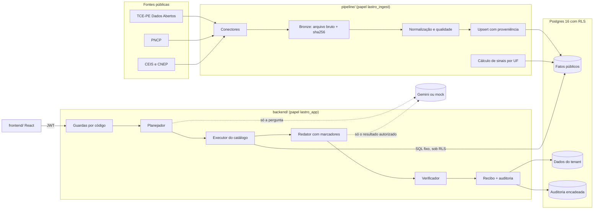

# Arquitetura

O Lastro tem quatro partes: a pipeline coleta dados públicos, o Postgres guarda e filtra, a API responde perguntas e a interface mostra tudo com a origem. Este documento descreve o que está no código. As decisões de fundo estão nos ADRs em `docs/adr/`.

## Visão geral

A LLM nunca fala com o banco. Ela recebe a pergunta (planejador) ou o resultado já filtrado pela RLS (redator), e nada além disso.

## Banco e controle de acesso

- **Papéis:** a API conecta como `lastro_app` e a pipeline como `lastro_ingest`, ambos criados em `db/migrations/000_roles.sh` com `nobypassrls`. O superusuário só aparece nas migrations e nos testes.
- **Contexto por transação:** `backend/app/core/db.py` abre uma transação por uso e grava `app.tenant_id`, `app.usuario_id`, `app.perfil`, `app.ufs` e `statement_timeout` (5 s) com `set_config(..., true)`. O contexto vem do JWT assinado no login, nunca do corpo da requisição.
- **RLS** (`db/migrations/002_rls.sql`), com `force row level security` em todas as tabelas:
  - **fatos públicos:** contratos, pagamentos e sinais aparecem só nas UFs da sessão. Fornecedores, órgãos e sanções ficam visíveis a qualquer usuário autenticado. Sócios, só para analista, auditor e admin;
  - **dados do tenant:** carteiras, consultas, recibos, alertas e auditoria ficam filtrados por tenant. O analista vê as próprias consultas e recibos; auditor e admin veem os do tenant inteiro;
  - **sem contexto:** nenhuma linha aparece.
- **Imutabilidade:** `lastro_app` não tem `update` nem `delete` em `recibos` e `auditoria`.
- **Auditoria encadeada:** um trigger `security definer` (`006_auditoria_seq_no_trigger.sql`) pega um lock por tenant, sorteia o `seq` e calcula `hash = sha256(hash_anterior | tenant | usuario | evento | detalhes | epoch)`. O `GET /auditoria/verificar` refaz a conta.
- **Pool de conexões:** cada conexão é testada antes de ser entregue. Se o Postgres reinicia, o pool repõe todas as conexões mortas de uma vez (SPEC §14.5).

## Pipeline (`pipeline/lastro_pipeline/`)

Cada execução segue os mesmos passos para todas as fontes (`runner.py`):

1. **Execução:** abre uma linha em `execucoes_ingestao`, gravada mesmo que a coleta falhe.
2. **Bronze:** cada resposta bruta vai para `data/raw/<fonte>/` e para `arquivos_brutos`, com o sha256 (`bronze.py`). Arquivo repetido não duplica.
3. **Normalização:** os conectores (`connectors/`) e normalizadores (`normalize/`) produzem fatos com proveniência:
   - CNPJ só com dígito verificador válido;
   - pessoa física é descartada e contada em `registros_descartados`;
   - dinheiro em `Decimal`.
4. **Gravação:** upsert por `(fonte_id, id_origem)`. O `hash_conteudo` é o sha256 do conteúdo canônico, sem a hora da coleta, então coletar de novo sem mudança não altera nada.
5. **Qualidade:** queda de volume em relação à execução anterior marca a execução como `parcial`. Qualquer erro marca `falhou` e desfaz os fatos da execução, sem apagar os anteriores.

O acesso às fontes respeita estes limites (`http.py`):
- uma requisição por segundo;
- retry com backoff exponencial;
- cache em disco;
- `User-Agent: lastro-hackathon`;
- 403 vira `FonteBloqueada`, sem tentar contornar.

**Sinais** (`sinais/regras.py`, `sinais/calculo.py`, comando `sinais`):
- `sancao_direta` (forte): sanção vigente no CEIS ou no CNEP.
- `penhasco` (atenção): 50% ou mais do valor vigente na UF termina em até 180 dias.
- `concentracao` (atenção): um órgão responde por 70% ou mais do valor dos últimos 24 meses na UF.

Todos são calculados por UF (ou nacionais, no caso da sanção). Cada um traz `explicacao`, `evidencias` e `versao_regra`.

## API (`backend/app/`)

FastAPI, Pydantic v2 e psycopg 3, com SQL explícito e sem ORM. Cada módulo tem `router.py`, `service.py`, `queries.py` ou `sql/`, e `schemas.py`.

| Módulo | Rotas |
|---|---|
| `auth` | `POST /auth/login` (bcrypt, JWT HS256 com tenant, perfil e UFs; 480 min), `GET /me` |
| `policy` | Matriz de perfis do SPEC §6.2; negação vira 403 e evento `negado` na auditoria |
| `consulta` | `POST /consultas`, `GET /consultas` |
| `catalogo` | Executor das intents (`registry.py` + `sql/<intent>.<conjunto>.sql`) |
| `recibos` | `GET /recibos/{id}`, `GET /recibos/{id}/verificar` |
| `carteiras` | `POST`/`GET /carteiras`, `GET /carteiras/{id}/fila` |
| `fornecedores` | `GET /fornecedores/{cnpj}/dossie` |
| `alertas`, `auditoria`, `fontes`, `metricas` | Leituras para as telas |

### Fluxo de uma pergunta (`modules/consulta/service.py`)

1. **Guardas por código** (`guardas.py`): pedido para ignorar regras, ver o prompt ou consultar outro cliente, e UF citada fora do escopo, são negados antes de qualquer LLM.
2. **Planejador** (`llm/planejador.py`): devolve um `PlanoConsulta` (`contracts/plano_consulta.schema.json`) com uma intent do catálogo e parâmetros tipados.
   - Com `LLM_PROVIDER=gemini`, o Gemini propõe o plano e o código valida. Se a saída vier inválida duas vezes ou o provedor estiver fora, o plano vem das regras (`llm/regras.py`).
   - Com `mock`, as regras planejam sozinhas.
3. **Executor** (`modules/catalogo/executor.py`): roda o SQL fixo da intent sob RLS. A interseção de UFs vem da sessão: pedir uma UF fora do escopo resulta em negação.
4. **Redator** (`llm/redator.py`): escreve só com marcadores `{{vN}}`, e o código insere os valores do resultado.
   - Sem LLM, ou se o texto da LLM for recusado, entra o modelo determinístico da intent (`llm/marcadores.py`). O planejador já ter caído não faz o redator esperar outro timeout.
5. **Verificador** (`llm/verificador.py`): reprova número, CNPJ, URL ou UF fora do resultado, marcador desconhecido, texto de prompt e linguagem de acusação. A reprovação troca o texto pelo modelo determinístico.
6. **Gravação:** consulta, recibo e eventos de auditoria entram numa transação só. O recibo (`contracts/recibo.schema.json`) traz pergunta, plano, parâmetros efetivos, linhas citadas com hash, fontes, valores, verificação e versões dos prompts. O `hash` é o sha256 do JSON canônico.

Intents com SQL: `resumo_fornecedor@v2`, `contratos_vigentes@v1`, `contratos_vencendo@v1`, `pagamentos_periodo@v2`, `sancoes_fornecedor@v1`, `orgaos_fornecedor@v1`, `busca_objeto@v1` (full-text em português no objeto do contrato).

`fila_carteira` e `socios_sancionados` estão no contrato do plano, mas ainda não têm SQL: viram abstenção, com recibo.

Limites:
- 30 consultas por minuto por usuário;
- pergunta com até 500 caracteres;
- timeout da LLM configurável (`LLM_TIMEOUT_SECONDS`, padrão 20 s);
- 5 s por comando no banco.

## Interface (`frontend/`)

React 18, TypeScript `strict`, TanStack Query e Tailwind com a paleta `kyu-*`. As telas só falam com a API por uma interface `Api` injetada, o que permite trocá-la por uma API falsa nos testes.

| Tela | O que mostra |
|---|---|
| 01 Consulta | Pergunta, resposta com valores destacados, citações e integridade |
| 02 Recibo | Registros de origem, totais reproduzíveis, selo verificado |
| 03 Acesso | Sessão e matriz de perfis |
| 04 Auditoria | Consultas e cadeia de eventos |
| 05 Fontes | Última coleta e histórico de execuções |
| 06 Carteiras e fila | Carteiras, fila priorizada com sinais |
| 07 Dossiê | Resumo, contratos, sanções, sinais, sócios e fontes de um fornecedor |
| 08 Métricas | Gabarito e ataques do `eval/` |

## Avaliação (`eval/`)

`run_eval.py gabarito` roda as 100 perguntas de `eval/gabarito/perguntas.yaml` contra a API e confere:
- a intent;
- o comportamento (responder, pedir detalhe, abster-se ou negar);
- as citações;
- o resultado, quando há `sql_referencia`.

`run_eval.py ataques` roda os 58 casos de `eval/ataques/ataques.yaml` e falha se houver qualquer vazamento. Os relatórios ficam em `eval/reports/` e alimentam a tela de métricas.

## Para produção

- **Identidade:** OIDC (Keycloak ou o IdP do cliente), RBAC + ABAC com motor de políticas, RLS mantida como última barreira.
- **Ingestão:** conectores para os 27 portais estaduais e municipais; fila (Celery ou RQ) com retry e dead letter; object storage para arquivos brutos; agendamento incremental; contratos de fonte testados diariamente.
- **Dados:** camadas bronze, prata e ouro; versionamento de registros e detecção de mudança de schema; catálogo semântico.
- **IA:** plano JSON compilado pelo backend com validação de AST para perguntas fora do catálogo; busca híbrida (full-text + vetorial) para documentos de licitação; reranker; avaliação contínua com o gabarito.
- **Operação:** OpenTelemetry, Prometheus e Grafana; custo por consulta; SLOs (P95 < 10 s com LLM); backups com teste de restauração; RPO e RTO definidos.
- **Segurança:** OWASP ASVS 5.0 e OWASP Top 10 para LLM como checklists; pentest; rotação de segredos.
- **Escala do negócio:** dado público coletado uma vez e reaproveitado por todos os clientes (reuso), carteiras ilimitadas por tenant, API para agentes de terceiros.
